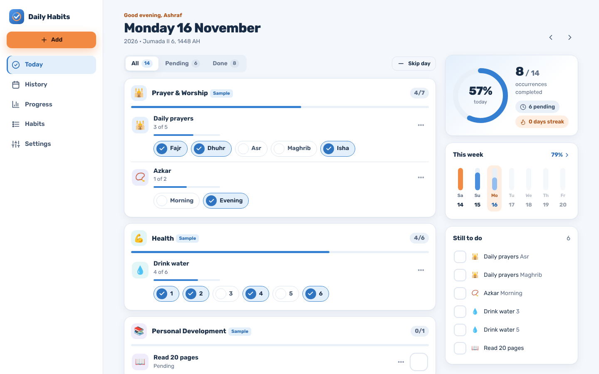

# Daily Habits

An installable, offline-first habit tracker (Progressive Web App). You create your own groups and habits, track habits that happen several times a day (like the five prayers) one occurrence at a time, and follow your progress day by day, week by week and month by month.

No build step, no server, no account. Plain HTML, CSS and JavaScript (ES modules), with data stored in the browser's IndexedDB.



## Features

- **Your own groups and habits.** Create, rename, recolor and delete them; drag to reorder (touch and mouse, with arrow buttons as a fallback). You can move habits between groups, and any habit can be added at any time.
- **Multiple daily occurrences.** Set a habit to happen N times a day. Each occurrence can have a name (Fajr, Dhuhr, Asr…) or just a number (water 1–8), and each one has its own checkbox and a permanent ID, so removing one (say, the 2nd) never moves another occurrence's ticks.
- **Skip / excused days.** Mark an occurrence, a habit or a whole day as *skipped* (travel, illness…). Skipped items don't count as planned or missed, and they don't break streaks.
- **Changes start today or tomorrow.** If you've already ticked a habit today and then change its schedule or occurrences, or pause it, you choose whether the change starts today or tomorrow (recommended), so today's record stays intact.
- **Frequencies:** every day, selected days of the week, or a weekly goal (for example, gym 3× per week).
- **Pause without losing history.** Paused habits disappear from your days and come back when you resume them. You can also archive a habit (hide it, keep its records) or delete it permanently.
- **Accurate history.** Editing a habit's schedule, occurrences or group takes effect from today. Past days keep the plan they actually had.
- **Today dashboard:** a progress ring, done vs planned, pending count, a streak, the current week at a glance, All/Pending/Done filters, and occurrences grouped and checked off with one tap.
- **History:** a monthly heat calendar and a day-by-day log that lists what was missed. Tap any date to open that exact day, where you can correct it too.
- **Progress:** weekly and monthly completion rate with change vs the previous period, good and perfect days, per-day bars, a per-group breakdown, a per-habit table (rate, streak, missed) and a 26-week consistency heatmap.
- **Settings:** your name, week start day (Saturday by default), the "good day" threshold, how the daily % is weighted (per occurrence or per habit), light/dark/auto theme, Hijri date, backup and restore with a preview, "bring back previous data", removal of sample data, and erase all.
- **PWA:** installable in Chrome (desktop and Android), runs standalone without browser UI, works offline, shows an update prompt when a new version is deployed, and supports app shortcuts.

## How progress is calculated

| Metric | Formula |
|---|---|
| **Day %** | completed ÷ planned occurrences that day. Planned = every occurrence of every active habit scheduled on that weekday, **minus skipped ones**. With the optional *Each habit counts the same* setting, every habit is worth 1 point and its occurrences are fractions of it. |
| **Week / Month %** | completed ÷ planned for daily and selected-day habits, for days up to today. The ▲/▼ comparison uses the **same number of elapsed days** of the previous week or month. |
| **Weekly goals** | reported **separately** (x / target per week; "weeks met" per month), so a week that has just started doesn't drag the rate down. |
| **Good day** | day % ≥ your threshold (80% by default). **Perfect day** = 100%. |
| **Overall streak** | consecutive good days. Today never breaks the streak while it's still in progress, and days with nothing planned are skipped. |
| **Habit streak** | consecutive scheduled days on which *all* occurrences were done. For weekly goals it counts consecutive weeks in which the target was met. |
| **Missed** | planned occurrences on past days that were neither ticked nor skipped. |

Weekly-goal habits aren't part of the daily % because they can be done on any day. They count toward week and month progress.

## Where your data lives

- Everything is stored in **IndexedDB** on the device: habits, groups, every completion record and your settings. The data survives reloads, browser restarts, app updates and going offline. On startup the app asks the browser to mark the storage as *persistent*, and installed PWAs normally get that permission.
- **Data does not sync between devices.** Your phone and your laptop each keep their own copy. To move or back up data, go to **Settings → Export backup**, which downloads a `.json` file, then **Restore from backup** on the other device. Export a backup now and then.
- Data is tied to the site's address (shown in Settings). If you change the GitHub Pages URL (for example, by renaming the repo or adding a custom domain), the app starts empty there. **Decide the final address before daily use**, and export and restore if you ever move. Clearing the browser's site data also erases it.
- **Safe restore.** A backup file is fully checked and previewed before anything changes. The replacement happens in a single database transaction (all or nothing), and your previous data is kept, so **Settings → Bring back** undoes a restore or an erase.
- **Failed saves are rolled back** and reported, instead of silently looking saved. Several open tabs or windows stay in sync.

## Run locally

Any static file server works. ES modules and service workers don't run from `file://`.

```bash
cd daily-habits
python3 -m http.server 8080
# open http://localhost:8080
```

(Or `npx serve .`.) `localhost` counts as a secure context, so installing and offline mode work locally too.

## Deploy with GitHub Pages

1. Create a repository (for example `daily-habits`) and push **the contents of this folder** to the repo root:
   ```bash
   git init && git add . && git commit -m "Daily Habits PWA"
   git branch -M main
   git remote add origin https://github.com/<you>/daily-habits.git
   git push -u origin main
   ```
2. In the repo, go to **Settings → Pages → Build and deployment**, set *Source: Deploy from a branch*, choose *Branch: `main` / `(root)`*, then **Save**.
3. After a minute the site is live at `https://<you>.github.io/daily-habits/`. Every path in the app is relative, so it works from a sub-path like this, or from a custom domain.

`.nojekyll` is included so GitHub serves the files as they are.

### Install it as an app (Chrome)

- **Desktop:** open the site and click the install icon at the right end of the address bar, or open the menu ⋮ and choose **Cast, save and share → Install page as app**. The app also shows an **Install app** button in the sidebar when Chrome allows it.
- **Android:** open the menu ⋮ and choose **Install app** (or **Add to Home screen**).

After that it opens in its own window with its own icon and no browser bar.

### Shipping updates

1. Edit the files.
2. In `sw.js`, bump `CACHE_VERSION` (for example `v1.2.0` → `v1.2.1`). Also change `APP_VERSION` in `js/app.js` if you like.
3. Commit and push. Open apps show **"A new version is ready → Update"**, and your data is left untouched.

Code (HTML/JS/CSS) is always fetched from the network first and revalidated, so a page can never run with a mix of old and new scripts, even if you forget to bump the version. The cache is only used offline.

## Project structure

```
index.html          App shell (sidebar / bottom tab bar, modal & toast roots)
manifest.json       PWA manifest (name, icons, standalone display, shortcuts, screenshots)
sw.js               Service worker (offline cache + update flow)
css/app.css         Design system (Blue & Orange, light/dark), responsive layout
fonts/              Rubik variable font (Latin + Arabic), SIL Open Font License
js/db.js            IndexedDB wrapper
js/model.js         Pure logic: dates, schedule versions, day/period stats, streaks
js/store.js         State + persistence (write-through to IndexedDB), backup/restore, samples
js/app.js           Router and views (Today, History, Progress, Habits, Settings), forms, actions
icons/              App icons (any + maskable), favicon, Apple touch icon
screenshots/        Used by Chrome's richer install dialog
tests/              End-to-end test suite (Playwright)
```

### Data model

```js
group      { id, name, icon, color, order, description, sample, deleted }
habit      { id, name, icon, color, order, notes, sample, archived,
             versions: [{ from: 'YYYY-MM-DD', groupId, status: 'active'|'paused'|'archived',
                          schedule: { type: 'daily'|'days'|'weekly', days: [0-6], perWeek },
                          occurrences: [{ id, label }] }] }
completion { key: 'date|habitId|occurrenceId', date, habitId, occId, at, state?: 'skipped' }  // no state = done
```

A completion is one row per ticked occurrence per day, so nothing is generated ahead of time and nothing is duplicated. The planned set for any date is worked out from the habit version in force on that date.

## Tests

`tests/test_app.py` (97 checks) drives the real app in headless Chrome at desktop and phone sizes. It covers CRUD for habits and groups, multiple occurrences (including removing a middle one), skip/excuse, today-vs-tomorrow changes, filters, persistence, history accuracy after edits, pause/archive/delete, drag and arrow reordering, weekly-goal and period maths, equal-weight scoring, safe restore and undo, failed-save rollback, multi-tab sync, update safety, keyboard focus, colours and contrast, the bundled font, installability (via Chrome DevTools) and offline loading.

```bash
pip install playwright && python -m playwright install chromium
python3 -m http.server 8765 &        # from the project root
python3 tests/test_app.py            # BASE_URL=http://localhost:8765/ by default
```

## Known limitations

- No cross-device sync or cloud account. Backup/restore covers moving data between devices. Real sync would need a backend (for example Supabase or Firebase).
- No push reminders or notifications yet.
- Streaks look back up to about 4 years.
- Weekly-goal habits can't be skipped per day (the goal is weekly by design).
- iOS Safari can install the app via *Share → Add to Home Screen*, but it may clear site data after long periods of non-use, so keep backups if you use it there.
